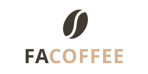

# FACOFFEE

Divisão de custos da copa da FACOM (UFMS).

> [!NOTE]
> Aplicação educativa, desenvolvida na disciplina Técnicas Avançadas de Desenvolvimento de Software (2026/2) para aplicar as técnicas e ferramentas vistas em aula. O problema e as pessoas são reais, mas o FACOFFEE é antes de tudo um exercício de engenharia: Domain-Driven Design, arquitetura de serviços com eventos, TDD, ADRs, CI e teste ponta a ponta.

Professores e técnicos administrativos da FACOM dividem, por vontade própria, o custo do café e dos demais itens da copa. Hoje um colega, o gestor, cobra, recebe, confere, compra, reembolsa e presta contas pelo WhatsApp, com anotações soltas e de memória. O FACOFFEE tira esse peso dele: organiza quem participa, quem pagou e quanto tem na caixinha, sem transformar o combinado entre colegas em cobrança formal.

> "Eu só quero manter as cotas da copa organizadas, com uma divisão justa, uma reserva para eventualidades e sem precisar ficar cobrando todo mundo o tempo inteiro." — gestor da copa

## Como funciona

Cada participante escolhe um tipo de cota: **só café** ou **completa** (café, bolachas, chás e os demais itens). No início do ano, o gestor define o valor de cada tipo de cota, com base nos gastos do ano anterior. Todo mês, cada participante deve a cota do seu tipo. Tudo o que é pago entra na **caixinha**, e todo gasto sai dela. Quando a caixinha não dá conta, o gestor pede um **complemento**, dividido igualmente entre os participantes ativos.

Os termos seguem o [glossário](docs/dominio/GLOSSARIO.md).

## O que o FACOFFEE faz

**Para o participante**

- Entrar, trocar de tipo de cota (vale a partir do mês seguinte) e sair.
- Ver se está em dia, pendente ou com crédito, sem perguntar ao gestor.
- Ver o saldo da caixinha, o total gasto no ano anterior e o resumo do mês: o que entrou, o que saiu com cada tipo de gasto e quanto sobrou.
- Registrar um gasto com o tipo e a nota e, se pagou do próprio bolso, receber o reembolso.
- Receber avisos por e-mail: valor da cota definido, pagamento recebido, complemento solicitado e reembolso feito.

**Para o gestor**

- Ver todos os participantes, com crédito e pendências.
- Receber pagamentos por PIX (com comprovante) ou em dinheiro. O que for pago a mais vira crédito e abate as próximas cotas sozinho.
- Reembolsar gastos, solicitar complemento e definir o valor da cota.
- Desativar e reativar o acesso de um participante.

**Sozinho**

- No início de cada mês, a cota de cada participante fica devida.
- No início do ano, sem valor definido pelo gestor, repete-se o do ano anterior.

O acesso é pelo Passaporte UFMS.

## Princípios

1. Continua um combinado entre colegas: voluntário, sem multa e sem juros.
2. Não dá mais trabalho a ninguém do que dá hoje.
3. Ninguém é exposto: cada participante vê só a própria situação; a lista de pendentes é só do gestor.
4. Só o gestor registra pagamento.
5. A caixinha é de todos: o saldo e os gastos ficam visíveis a todos.
6. O consumo não é medido nem controlado.

Fora do escopo: controle de consumo ou de estoque, multa, bloqueio, lista pública de pendentes e cobrança automática. Detalhes, métricas de sucesso e questões em aberto na [visão de produto](docs/produto/VISAO.md).

## Estágio

Em desenvolvimento ao longo da disciplina. O backlog está nas [issues](../../issues), organizado nos [milestones](../../milestones):

| Milestone | Conteúdo |
|---|---|
| M0 Fundação | Estrutura, ambiente local, contratos de eventos, template de serviço e CI |
| M1 Usuário + Participação | Acesso pelo Passaporte UFMS, participação, tipo e valor da cota, agendador |
| M2 Financeiro | Pagamentos, crédito e pendentes, gastos, reembolsos, caixinha, complemento |
| M3 Notificação + Web | Avisos, telas do participante e do gestor, teste ponta a ponta |

Próximos passos do produto: lembrar os pendentes sem o gestor cobrar ([#72](../../issues/72)) e explicar o valor de cada tipo de cota a partir dos gastos do ano anterior ([#77](../../issues/77)).

## Documentação

- [Documentação](docs/README.md): produto, domínio, arquitetura, ADRs e design
- [Contribuindo](CONTRIBUTING.md): estrutura, ambiente local, comandos, branch e PR, commits
- [Práticas de engenharia](AGENTS.md): fluxo, versionamento, TDD, DDD, ADRs e estilo
