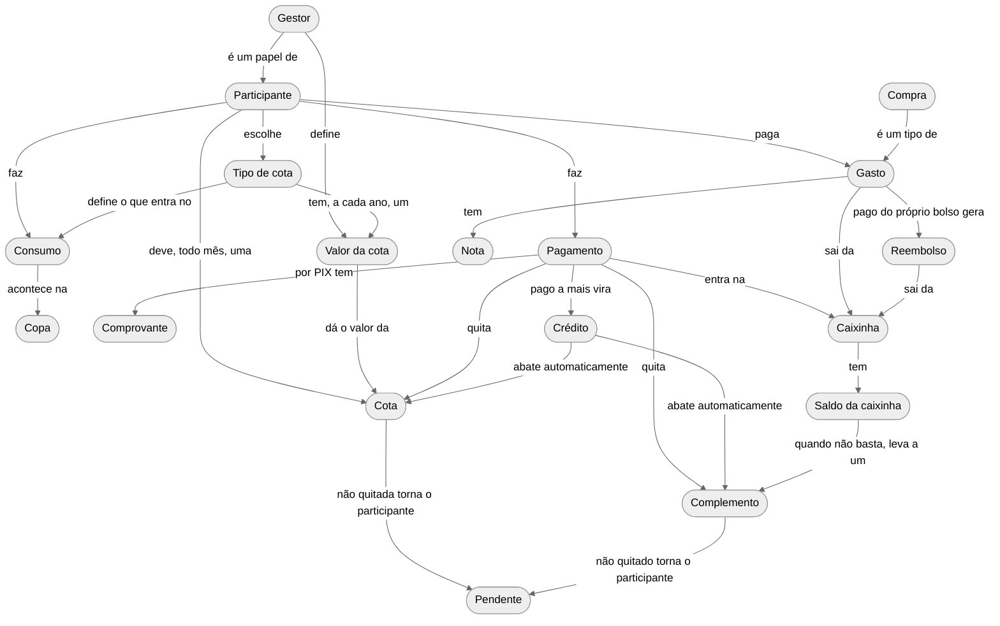
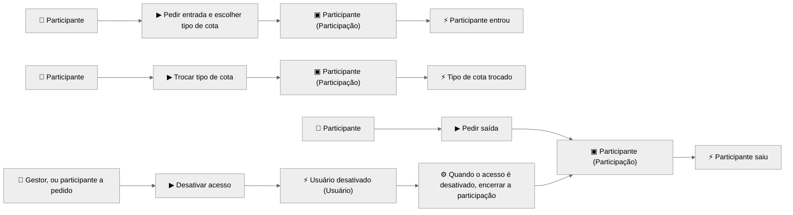
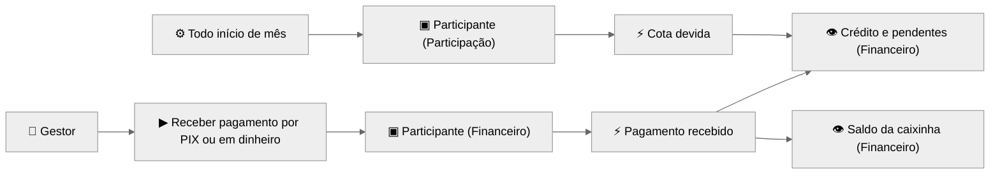
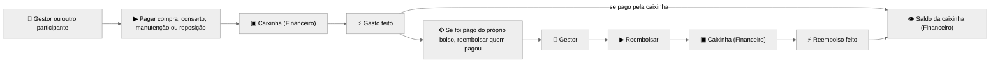
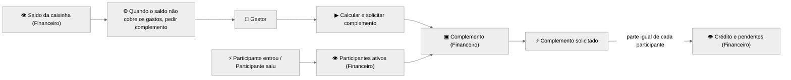
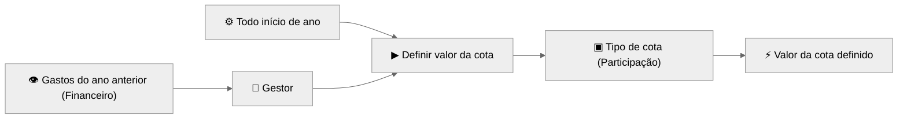
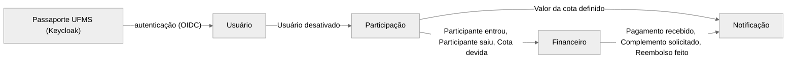

# Modelos de Domínio: FACOFFEE

| | |
|---|---|
| **Escopo** | Divisão de custos da copa da FACOM |
| **Sistema** | FACOFFEE |
| **Disciplina** | Técnicas Avançadas de Desenvolvimento de Software (2026/2) |
| **Versão** | 2.4 |
| **Data** | 2026-10-25 |
| **Status** | Aprovado |
| **Base** | [Glossário da Linguagem Ubíqua](GLOSSARIO.md) (versão 2.3) e arquitetura do FACOFFEE ([arquitetura.png](arquitetura.png)) |

## Propósito

Este documento representa o domínio descrito no glossário de três formas:

1. **[Mapa conceitual](#1-mapa-conceitual)**: mostra os conceitos do domínio e como eles se relacionam.
2. **[Event Storming](#2-event-storming)**: mostra o que acontece no domínio, quem provoca cada acontecimento e quais regras reagem a ele.
3. **[Contextos delimitados](#3-contextos-delimitados)**: mostra como o domínio está dividido no FACOFFEE e quais eventos passam de um contexto para outro.

Os modelos usam apenas termos do glossário. A exceção é a seção 3, que também nomeia contextos da arquitetura cujos termos não estão no glossário (Usuário e Notificação). Os diagramas estão em [Mermaid](https://mermaid.js.org/) e aparecem renderizados no GitHub, no GitLab e em editores com suporte a Mermaid.

## 1. Mapa conceitual

O mapa conceitual mostra os conceitos do domínio e as relações entre eles. Cada seta, lida junto com os conceitos das pontas, forma uma frase sobre o domínio, por exemplo: *Participante escolhe Tipo de cota*. O mapa usa apenas termos do glossário e não representa dados, banco de dados nem sistema.

### Contexto de cada conceito

| Contexto | Conceitos |
|---|---|
| **Participação** | Participante (situação e tipo de cota), Gestor, Tipo de cota, Valor da cota, Cota (quando passa a ser devida) |
| **Financeiro** | Participante (o que deve, pagou e tem de crédito), Cota (quando é quitada), Pagamento, Comprovante, Crédito, Pendente, Complemento, Caixinha, Saldo da caixinha, Gasto, Compra, Nota, Reembolso |
| **Fora do sistema** | Consumo e Copa, que não são registrados |

### Decisões de modelagem

| Decisão | Motivo no glossário |
|---|---|
| **Gestor** é um papel de **Participante**. | O gestor também é um participante, com tipo de cota e cotas. |
| **Pendente**, **Saldo da caixinha** e **Consumo** aparecem como conceitos. | São termos do glossário. Pendente e Saldo da caixinha são calculados a partir de outros conceitos; o Consumo não é medido nem anotado. |
| **Nota** e **Reembolso** ligam-se a **Gasto**, não só a Compra. | O reembolso cobre qualquer gasto pago do próprio bolso: compra, conserto, manutenção ou reposição. |
| **Compra** é um tipo de **Gasto**. | O gasto inclui compras de itens, além de conserto, manutenção e reposição. |
| Um gasto pago do próprio bolso só sai da caixinha no **Reembolso**. | Assim o mesmo dinheiro não sai da caixinha duas vezes: uma no gasto e outra no reembolso. |
| **Cota** e **Complemento** são quitados por pagamento ou abatidos do **Crédito**. | O crédito é abatido automaticamente; para o participante deixar de estar pendente, basta a cota ou o complemento ser pago ou abatido. |
| **Participante** e **Cota** são tratados em dois contextos. | Em Participação importa se a pessoa participa e com qual tipo de cota; em Financeiro importa o que ela deve, pagou e tem de crédito. |
| O mapa mostra só as relações essenciais. | Ações do gestor, como receber pagamentos, solicitar complementos e fazer reembolsos, estão no glossário e no [Event Storming](#2-event-storming). |

## 2. Event Storming

O Event Storming foi enxugado para ter apenas os eventos que mudam algo no domínio. Situações que podem ser calculadas a partir desses eventos, como o crédito, as pendências e o saldo da caixinha, aparecem como leituras.

### Legenda

Os diagramas não usam cores nem formatos diferentes. Cada elemento é identificado pela marca no início do texto. Agregados, eventos e leituras trazem o contexto entre parênteses.

| Marca | Elemento | O que representa |
|---|---|---|
| ⚡ | Evento | Algo que aconteceu no domínio, escrito no passado. |
| ▶ | Comando | Uma ação que alguém decide fazer. |
| 👤 | Ator | Quem executa o comando. |
| ▣ | Agregado | O elemento que recebe o comando e garante as regras. |
| ⚙ | Política | Uma regra do tipo "quando isso acontece, então..."; inclui gatilhos de tempo. |
| 👁 | Leitura | A informação calculada que alguém consulta para decidir. |
| ⚠ | Ponto crítico | Uma dúvida ou risco que precisa ser validado. |

### 2.1 Participação

O acesso é desativado pelo gestor ou a pedido do próprio participante, no contexto Usuário. Em qualquer caso, a participação termina. Retornar é pedir a entrada de novo. As regras de troca, saída e retorno estão no agregado [Participante (Participação)](#agregados).

### 2.2 Cobrança e pagamento

A cota passa a ser devida em Participação, que sabe o tipo de cota do participante naquele mês. Quem entra durante o mês também deve a cota daquele mês. Financeiro recebe o evento *Cota devida* com o valor e passa a cobrá-la.

O comando de pagamento é do gestor: o participante entrega o dinheiro, e é o gestor quem o recebe.

O crédito é abatido automaticamente: cada nova cota ou parte de complemento consome primeiro o crédito do participante, sem comando de ninguém.

### 2.3 Gastos

### 2.4 Complemento

O complemento é dividido entre todos os participantes ativos no momento da solicitação, inclusive os pendentes. Financeiro sabe quem participa porque acompanha os eventos *Participante entrou* e *Participante saiu*.

### 2.5 Valor da cota

O gestor consulta os gastos do ano anterior em Financeiro e define o valor em Participação. Nenhum contexto consulta o outro diretamente. Se o gestor não define o valor de um tipo de cota até o início do ano, a política repete o valor do ano anterior e publica *Valor da cota definido*.

### Eventos

A coluna **Publicado para** indica quais contextos recebem o evento. Os eventos marcados como *interno* ficam só no contexto onde acontecem. Os contextos estão descritos na [seção 3](#3-contextos-delimitados).

| # | Evento | O que aconteceu | Contexto e agregado | Gatilho | Publicado para |
|---|---|---|---|---|---|
| 1 | **Valor da cota definido** | O gestor definiu o valor de cada tipo de cota para o ano. | Participação: Tipo de cota | Início do ano | Notificação |
| 2 | **Participante entrou** | Uma pessoa passou a participar, pela primeira vez ou retornando, com um tipo de cota. | Participação: Participante | *Pedir entrada e escolher tipo de cota* | Financeiro |
| 3 | **Tipo de cota trocado** | O participante mudou de só café para completa, ou o contrário. | Participação: Participante | *Trocar tipo de cota* | *interno* |
| 4 | **Participante saiu** | O participante pediu a saída ou teve o acesso desativado. | Participação: Participante | *Pedir saída* ou *Usuário desativado* | Financeiro |
| 5 | **Cota devida** | O participante passou a dever a cota do mês, com o valor do seu tipo de cota. | Participação: Participante | Início do mês | Financeiro |
| 6 | **Pagamento recebido** | O gestor recebeu dinheiro de um participante, por PIX com comprovante ou em mãos. | Financeiro: Participante | *Receber pagamento por PIX ou em dinheiro* | Notificação |
| 7 | **Complemento solicitado** | O gestor pediu um complemento; cada participante ativo passou a dever uma parte igual. | Financeiro: Complemento | Saldo da caixinha insuficiente | Notificação |
| 8 | **Gasto feito** | Alguém pagou uma compra, um conserto, uma manutenção ou uma reposição, com dinheiro da caixinha ou do próprio bolso, e guardou a nota. | Financeiro: Caixinha | *Pagar compra, conserto, manutenção ou reposição* | *interno* |
| 9 | **Reembolso feito** | O gestor devolveu o valor a quem pagou um gasto do próprio bolso. | Financeiro: Caixinha | Gasto pago do próprio bolso | Notificação |

O contexto Participação também recebe um evento do contexto Usuário:

| Evento | O que aconteceu | Contexto de origem | Efeito no domínio |
|---|---|---|---|
| **Usuário desativado** | O acesso de uma pessoa ao FACOFFEE foi desativado, pelo gestor ou a pedido da própria pessoa. | Usuário | Se a pessoa estiver participando, a participação é encerrada (*Participante saiu*). |

### Leituras

| Leitura | Contexto | Como é calculada | Quem usa e para quê |
|---|---|---|---|
| **Crédito e pendentes** | Financeiro | Para cada participante: pagamentos recebidos menos cotas devidas e partes de complementos. Se o resultado é positivo, é crédito; se é negativo, o participante está pendente. | O gestor, para lembrar quem deve; o participante, para saber a própria situação. |
| **Saldo da caixinha** | Financeiro | Pagamentos recebidos menos gastos pagos pela caixinha e reembolsos feitos. | O gestor, para decidir se precisa pedir complemento; os participantes, para acompanhar. |
| **Gastos do ano anterior** | Financeiro | Soma dos gastos feitos no ano anterior. | O gestor, para definir o valor da cota. |
| **Participantes ativos** | Financeiro | Quem entrou e ainda não saiu, segundo os eventos de Participação. | O complemento, para ser dividido em partes iguais. |

### Agregados

| Agregado | Contexto | O que reúne | Regras que garante |
|---|---|---|---|
| **Participante** | Participação | Situação, tipo de cota e cotas devidas | A troca de tipo vale a partir do mês seguinte. A cota é devida enquanto a pessoa participa, com o valor do tipo de cota naquele mês. A participação termina quando a pessoa pede a saída ou tem o acesso desativado. |
| **Tipo de cota** | Participação | Valor de cada ano | O valor não muda durante o ano. |
| **Participante** | Financeiro | Cotas devidas, pagamentos, partes de complementos e crédito | O que for pago a mais fica como crédito e abate automaticamente o que vier depois. Na saída, o que foi pago adiantado fica como crédito, e o crédito ou a pendência continuam valendo quando a pessoa retornar. |
| **Caixinha** | Financeiro | Gastos e reembolsos | Um gasto pago do próprio bolso gera reembolso. O dinheiro desse gasto só sai da caixinha no reembolso. |
| **Complemento** | Financeiro | Valor total e valor por participante | É dividido em partes iguais entre todos os participantes ativos no momento da solicitação. |

### Decisões do modelo enxuto

| Decisão | Efeito |
|---|---|
| Início do mês e início do ano são gatilhos de política, não eventos. | Saíram *Mês iniciado* e *Ano iniciado*. No FACOFFEE, quem dispara esses gatilhos é o agendador, um processo agendado na rede interna que chama Participação. |
| Crédito, pendência e saldo da caixinha são leituras calculadas. | Saíram os eventos de quitação, de crédito e de entrada e saída de dinheiro da caixinha. |
| O crédito é abatido automaticamente. | Não existem os eventos *Crédito abatido* e *Cota quitada*; a quitação aparece na leitura *Crédito e pendentes*. |
| O pagamento adiantado vira crédito, abatido mês a mês. | A regra de saída ("os meses pagos adiantado viram crédito") passa a acontecer sozinha. |
| Retornar é entrar de novo. | Saiu *Participante retornou*. |
| A compra é um tipo de gasto. | *Compra feita* e *Gasto pago* viraram um só evento: *Gasto feito*. |
| O complemento já define a parte de cada participante. | *Complemento solicitado* e *Complemento devido* viraram um só evento. |
| Lembrar um pendente não muda nada no domínio. | Saiu *Pendente cobrado*. |
| A desativação do acesso acontece no contexto Usuário, mas tem efeito em Participação. | *Usuário desativado* vem do contexto Usuário e é traduzido em *Participante saiu*. |
| Só vai para outros contextos o evento que alguém usa. | *Tipo de cota trocado* e *Gasto feito* ficam internos. *Cota devida* já leva o valor do tipo de cota, e o saldo da caixinha é calculado no próprio Financeiro. |

## 3. Contextos delimitados

O FACOFFEE divide o domínio em três contextos de negócio e usa um contexto de apoio. O diagrama completo da arquitetura está em [arquitetura.png](arquitetura.png).

| Contexto | Tipo | Responsabilidade | Termos do glossário |
|---|---|---|---|
| **Participação** | Negócio | Quem participa, com qual tipo de cota, quanto vale cada tipo e quais cotas são devidas a cada mês. | Participante, Gestor, Tipo de cota, Valor da cota, Cota |
| **Financeiro** | Negócio | O dinheiro: pagamentos, crédito, pendências, complementos, gastos, reembolsos e caixinha. | Pagamento, Comprovante, Crédito, Pendente, Complemento, Caixinha, Saldo da caixinha, Gasto, Compra, Nota, Reembolso |
| **Usuário** | Negócio | O acesso das pessoas ao FACOFFEE, autenticadas pelo Passaporte UFMS (Keycloak). | — |
| **Notificação** | Apoio | Os avisos aos participantes, por e-mail e WhatsApp. | — |

### Mapa de contextos

As setas vão de quem publica para quem consome. A dependência entre os contextos de negócio tem uma só direção: Usuário → Participação → Financeiro. Participação traduz *Usuário desativado* para a linguagem do domínio, encerrando a participação. Assim, o termo "usuário" não entra no modelo de Participação.

### Eventos entre contextos

| Contexto | Publica | Consome |
|---|---|---|
| **Usuário** | Usuário desativado | — |
| **Participação** | Participante entrou, Participante saiu, Cota devida, Valor da cota definido | Usuário desativado |
| **Financeiro** | Pagamento recebido, Complemento solicitado, Reembolso feito | Cota devida, Participante entrou, Participante saiu |
| **Notificação** | — | Valor da cota definido, Pagamento recebido, Complemento solicitado, Reembolso feito |

### Pontos críticos para validar

Nenhum ponto crítico em aberto nesta versão.

## Histórico de revisões

| Versão | Data | Alterações |
|---|---|---|
| 1.0 | 2026-10-09 | Primeira versão: modelo conceitual e Event Storming. |
| 1.1 | 2026-10-09 | Nota e Reembolso ligados a Gasto; Event Storming enxugado. |
| 2.0 | 2026-10-24 | Revisão a partir da arquitetura do FACOFFEE. Nova seção [3. Contextos delimitados](#3-contextos-delimitados), com mapa de contextos e eventos entre contextos. Agregados, eventos e leituras passam a indicar o contexto. O agregado Participante foi dividido entre Participação e Financeiro. O pagamento passa a ser recebido pelo gestor. A desativação do acesso encerra a participação. Nova leitura *Participantes do momento*. O ponto crítico sobre a divisão do complemento foi resolvido (participantes do momento da solicitação) e entrou o ponto crítico sobre a desativação do acesso. |
| 2.1 | 2026-10-24 | Decisões: o crédito é abatido automaticamente (ponto crítico fechado) e o complemento é dividido entre todos os participantes ativos. A leitura *Participantes do momento* passa a se chamar *Participantes ativos*. O acesso é desativado pelo gestor ou a pedido do participante, e isso encerra a participação (ponto crítico fechado). |
| 2.2 | 2026-10-24 | O diagrama de classes foi substituído por um [mapa conceitual](#1-mapa-conceitual). Pendente, Saldo da caixinha e Consumo passam a aparecer como conceitos. |
| 2.3 | 2026-10-24 | Usuário passa a ser contexto de negócio, alinhado à arquitetura e ao [ADR 0001](adr/0001-arquitetura-servicos.md). O agendador é um processo agendado na rede interna que chama Participação. |
| 2.4 | 2026-10-25 | Quem entra durante o mês também deve a cota daquele mês. Sem definição do gestor até o início do ano, o valor da cota repete o do ano anterior ([ADR 0017](adr/0017-gatilhos-de-tempo-do-agendador.md)). |
